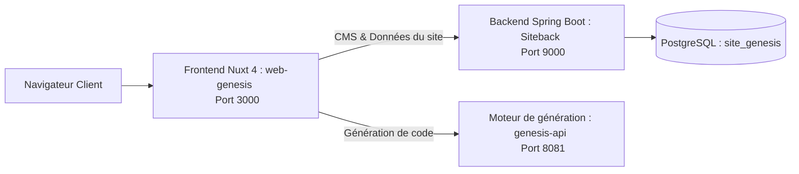

# Genesis — Site Vitrine & Studio de Génération V2

Projet complet du site vitrine et du studio interactif (Playground) de **Genesis**, générateur de projets full-stack open-source (backend, frontend, base de données et sécurité) basé sur le schéma d'une base de données ou un script SQL.

---

## 📑 Sommaire

1. [Vue d'ensemble de l'architecture](#1-vue-densemble-de-larchitecture)
2. [Structure détaillée du projet](#2-structure-détaillée-du-projet)
3. [Le Backend : Siteback (Spring Boot)](#3-le-backend--siteback-spring-boot)
4. [Le Frontend : web-genesis (Nuxt 4 / Vue 3)](#4-le-frontend--web-genesis-nuxt-4--vue-3)
5. [Le Playground interactif (Générateur)](#5-le-playground-interactif-générateur)
6. [Charte Graphique & Identité Visuelle](#6-charte-graphique--identité-visuelle)
7. [Installation et Lancement](#7-installation-et-lancement)

---

## 1. Vue d'ensemble de l'architecture

Le projet repose sur une architecture découplée articulée autour de 3 briques :



- **Frontend (`web-genesis`)** : Application Nuxt 4 (Vue 3, TypeScript, Tailwind CSS) offrant les pages vitrine dynamiques (Documentation, Écosystème, À propos, Équipe), un espace d'administration CMS et le studio Playground pour configurer et générer un projet.
- **Backend CMS (`Siteback`)** : API REST Spring Boot 3 générée par Genesis pour piloter le contenu dynamique du site (menus de navigation, pages HTML associées, liste de l'équipe, fichier de la charte graphique).
- **Moteur de génération (`genesis-api`)** : API locale de génération de code Genesis effectuant l'analyse des scripts SQL, la détection des relations et l'écriture de l'arborescence du projet généré.

---

## 2. Structure détaillée du projet

```text
Site vitrineV2/
├── README.md                      # Documentation globale du projet
├── TODO                           # Spécifications fonctionnelles, schéma relationnel et routes
├── Siteback/
│   └── Siteback/                  # Application Spring Boot 3 (API REST CMS)
│       ├── pom.xml                # Configuration Maven & dépendances
│       ├── config/                # Visibilité des colonnes (column-visibility.json)
│       └── src/main/java/org/example/siteback/
│           ├── controllers/       # Points d'entrée REST (/siteback/t-navbars, etc.)
│           ├── models/            # Entités JPA (TNavbar, TContent, TEquipe, etc.)
│           ├── repositories/      # Interfaces Spring Data JPA
│           ├── services/          # Logique métier et implémentations
│           ├── config/            # Configuration Spring (CORS, Swagger/OpenAPI)
│           ├── dto/               # Objets de transfert de données
│           └── exception/         # Gestionnaire global d'exceptions
└── web-genesis/                   # Application Frontend Nuxt 4 / Vue 3
    ├── package.json               # Scripts et dépendances pnpm
    ├── nuxt.config.ts             # Configuration Nuxt (Tailwind, modules, Nitro)
    ├── app/
    │   ├── app.vue                # Point d'entrée de l'interface Vue
    │   ├── assets/css/site.css    # Feuille de style globale et charte Genesis
    │   ├── components/            # Composants partagés (Topbar, Footer, DocsShell)
    │   │   └── playground/        # Composants des 8 étapes du générateur
    │   ├── composables/           # Logique réactive (usePlayground, useNavigation, useTheme)
    │   ├── pages/                 # Routage automatique Nuxt (docs, ecosystem, about, playground)
    │   └── genesis-core/          # Design System embarqué (polices, icônes SVG, styles)
    ├── server/api/                # Routes serveur Nitro (upload, fichiers de contenu, dossiers)
    └── public/                    # Fichiers statiques, polices WOFF2, SVG et pages HTML du CMS
```

---

## 3. Le Backend : Siteback (Spring Boot)

Le backend `Siteback` fournit l'API REST nécessaire pour alimenter dynamiquement le site vitrine.

### Modèles de données (JPA Entities)

| Entité | Table | Description |
|---|---|---|
| `TNavbar` | `t_navbar` | Onglets principaux de la barre de navigation (Docs, Écosystème, À propos, etc.). |
| `TContent` | `content` | Sous-pages rattachées à un onglet (`t_navbar_id`), contenant le libellé et le chemin vers le fichier HTML (`fichier`). |
| `TEquipe` | `t_equipe` | Membres de l'équipe : nom, prénom, rôle, email, photo, liens GitHub et LinkedIn. |
| `TCharteGraphique` | `t_charte_graphique` | Référence vers le fichier PDF officiel de la charte graphique. |
| `ColumnVisibility` | `column_visibility` | Préférences d'affichage des colonnes pour les tables administratives. |

### Contrôleurs REST

- `GET /siteback/t-navbars` : Récupère la liste des sections de navigation avec leurs contenus respectifs.
- `GET /siteback/t-contents` : CRUD des contenus et liaison aux fichiers HTML.
- `GET /siteback/t-equipes` : Récupère la grille des membres de l'équipe pour la page `/about/team`.
- `GET /siteback/t-charte-graphiques` : Fournit le lien de téléchargement de la charte graphique en PDF.

---

## 4. Le Frontend : web-genesis (Nuxt 4 / Vue 3)

### Système de rendu dynamique (CMS)
- Chaque page de documentation ou de présentation correspond à un fragment HTML stocké dans `web-genesis/public/upload/navbar/` (ex. `docs-quick-start.html`, `about-charte-graphique.html`, `ecosystem-frameworks.html`).
- Le composant `PageRenderer.vue` et `CmsPage.vue` injecte dynamiquement ce fragment, met à jour les liens internes et les ancres de navigation, et assure un fallback local transparent si le backend `Siteback` n'est pas démarré.

### Thèmes Sombre & Clair (`useTheme.ts`)
- Le site prend en charge le mode sombre (`genesis-dark`, actif par défaut) et le mode clair (`genesis-light`) via l'attribut `[data-theme="light"]` sur l'élément racine `:root`.
- Les variables CSS (`--bg-dark`, `--bg-light`, `--text`, `--brand`, etc.) adaptent l'interface en temps réel selon les directives de la charte graphique.

---

## 5. Le Playground interactif (Générateur)

Accessible sur `/playground`, il guide l'utilisateur à travers un assistant pas-à-pas pour configurer et générer une application :

1. **Step 1 - Projet (`PgStepProject.vue`)** : Nom du projet, package racine (`com.example`), version du langage (Java, C#, Python, etc.) et outil de build (Maven, Gradle, etc.).
2. **Step 2 - Framework Backend (`PgStepFramework.vue`)** : Choix du framework serveur (Spring Boot, NestJS, Django, ASP.NET Core, Express, Laravel, etc.).
3. **Step 3 - Base de données (`PgStepDatabase.vue`)** : Choix du SGBD cible (PostgreSQL, MySQL, Oracle, SQL Server).
4. **Step 4 - Script SQL (`PgStepScript.vue`)** : Dépôt ou saisie d'un script SQL DDL. Le moteur analyse automatiquement les instructions `CREATE TABLE` et extrait les tables et vues.
5. **Step 5 - Relations (`PgStepRelations.vue`)** : Visualisation et configuration des clés étrangères et relations inter-tables.
6. **Step 6 - Formulaires & Composants (`PgStepForms.vue`)** : Sélection des champs éditables et des composants d'affichage.
7. **Step 7 - Framework Frontend (`PgStepFrontend.vue`)** : Option d'ajouter une interface frontend (React, Vue, Angular, Svelte) et définition des ports réseau (ex. 8080 backend, 3000 frontend).
8. **Step 8 - Résumé & Génération (`PgStepSummary.vue`)** : Récapitulatif complet et déclenchement de la génération locale ou téléchargement du projet en archive ZIP.

La coordination de ces étapes est pilotée par le composable `usePlayground.ts` qui appelle séquentiellement les endpoints de `genesis-api` :
```text
DELETE /api/generator/reset
  └── POST /api/generator/frameworks/{id}/select
        └── POST /api/generator/script-database-config
              └── POST /api/generator/project-config
                    └── POST /api/generator/frontend-config
                          └── POST /api/generator/script/launch
```

---

## 6. Charte Graphique & Identité Visuelle

L'identité visuelle est rigoureusement conforme au document officiel `charte_graphique-V2.pdf`.

### 1. Le Logo et le Nom « Genesis » (Landscape Lockup)
Conformément aux pages 13 et 25 de la charte graphique (*Landscape Lockup & Construction*) :
- **Alignement sur la ligne de base (Baseline)** : Le mot « Genesis » et la mascotte « Genie » reposent sur la même ligne de base horizontale (`align-items: flex-end; line-height: 1`).
- **Proportions** : La hauteur de capitale de la lettre **G** s'aligne sur le haut de la tête de la mascotte (juste en dessous de la mèche de cheveux). La mascotte mesure 3 unités $n$ et la lettre $G$ mesure 2 unités $n$.
- **Espacement (Clear Space)** : L'espace horizontal entre la mascotte et le mot « Genesis » équivaut exactement à la largeur d'un $n$ (soit `gap: 0.55em`).
- **Couleur officielle de marque** :
  - En mode clair comme en mode sombre, le texte « Genesis » du logotype conserve sa couleur verte officielle de marque **`#00F549`** (ou `#00E043` en mode sombre).
  - La charte interdit formellement d'altérer la couleur de la typographie du logo (pas d'assombrissement arbitraire tel que `hsl(138, 100%, 32%)`).

### 2. Typographies
- **Titres Display & Logotype** : `Chillax Variable` (graisse 600 - SemiBold).
- **Sous-titres, Corps de texte & Interface** : `Poppins Variable` (graisses 400 et 600).
- **Code source & Terminaux** : `JetBrains Mono`.

### 3. Palette de Couleurs

| Rôle | Light Mode | Dark Mode | Usage |
|---|---|---|---|
| **Primary (Brand)** | `#00F549` (`hsl(138, 100%, 48%)`) | `#00E043` (`hsl(138, 100%, 44%)`) | Mascotte, logotype, surbrillances clés |
| **Accent** | `#F5C400` | `#EBBC00` | Boutons d'action principale (« Suivant », CTA) |
| **Secondary** | `#009AD6` | `#29B8FF` | Liens d'information, pagination, badges |
| **Background** | `#C7F0D4` / `#FFFFFF` | `#002421` / `#000F0F` | Fonds de page et cartes |
| **Text** | `#001F1F` | `#E0FFFF` | Typographie principale |

---

## 7. Installation et Lancement

### Prérequis
- **Node.js** 18+ et **pnpm** 9+
- **Java** 17 ou 21 (JDK) et **Maven** (pour Siteback)
- **PostgreSQL** (base de données `site_genesis`)

### 1. Démarrer le Backend (Siteback)
```bash
cd Siteback/Siteback
mvn spring-boot:run
# L'API démarre sur http://localhost:9000/siteback
```

### 2. Démarrer le Frontend (web-genesis)
```bash
cd web-genesis
pnpm install
pnpm dev
# Le site vitrine est accessible sur http://localhost:3000
```

### 3. Démarrer le moteur de génération Genesis (Optionnel pour le Playground)
```bash
java -jar genesis-api/build/libs/genesis-api-1.0.0.jar
# L'API tourne sur http://127.0.0.1:8081/api
```

